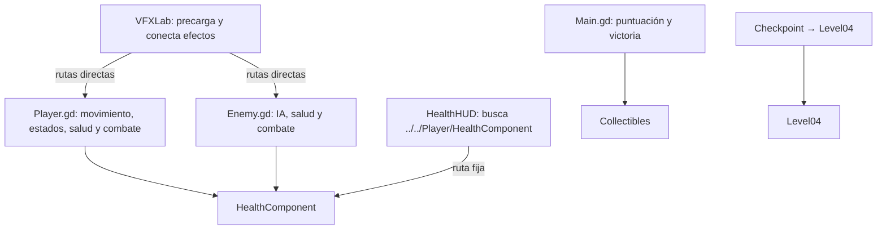
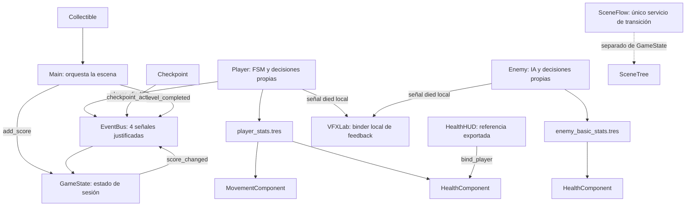

# Semana 11: arquitectura y sistemas reutilizables

## Alcance

Se reorganizan responsabilidades sin añadir mecánicas nuevas. Se conserva `Player`, `Enemy`, combate, salud, VFX, coleccionables y checkpoints. La lista de regresión del paso 37 queda pendiente para que la ejecute el estudiante.

Antes de editar se copió `project.godot`, `scripts/`, `scenes/`, `resources/`, `ui/`, `materials/` y `shaders/` a `C:/Users/Dayli/Documents/Codex/2026-11-03/c-users-dayli-documents-godotproyectos-git1/work/week11_git2_baseline`.

## Diagrama antes

## Diagrama después

## Decisiones de implementación

- `CharacterStats` contiene configuración base compartida; `current_health`, estado de FSM y velocidad actual permanecen en nodos runtime.
- `player_stats.tres` conserva 40 de vida, velocidad 280, aceleración 1700, daño 10 y retroceso 280, que coinciden con los valores actuales.
- `enemy_basic_stats.tres` conserva 40 de vida, velocidad de persecución 150, daño 10 y retroceso 280.
- `Player` delega solo el cálculo de velocidad horizontal a `MovementComponent`; salto, dash y FSM siguen en `Player.gd`.
- `HealthComponent.configure_from_stats()` exige una configuración válida y reinicia la vida al valor máximo. Player, Enemy y EnemyDummy reciben Resources explícitos.
- `AttackData` se duplica por actor antes de aplicar sus estadísticas para evitar mutar el `.tres` compartido.
- `HealthHUD` recibe `Player` por export y se suscribe a `health_changed`; no busca una ruta fija desde su propio script.
- `VFXLab` recibe escenas y materiales por exports. El binder local escucha señales de Player/Enemy; Hitbox/Hurtbox no conocen partículas ni cámara.
- `EventBus` contiene solo `player_died`, `checkpoint_activated`, `score_changed` y `level_completed`. `GameState` guarda puntuación, checkpoint activo, nivel actual y niveles completados.
- `SceneFlow` se limita a cambios de escena. No se añadió un manager general. Para probar la transición entre niveles existentes, `VFXLab` incluye un botón a `combat_lab.tscn` y Combat Lab ofrece un botón de regreso a VFX Lab. No se cambia de escena automáticamente al completar coleccionables.
- El audio de colección permanece local en `Collectible`, porque acompaña a esa escena y no necesita persistir entre niveles.
- Los grupos `player`, `enemy`, `damageable`, `checkpoint`, `hazard` y `collectible` identifican categorías; las relaciones importantes siguen usando referencias tipadas o señales directas.

## Paso 37: checklist pendiente

No se ejecutó esta lista. La configuración queda para que el estudiante registre el resultado después de probar en Godot.

| Prueba | Resultado |
|---|---|
| Player se mueve y salta | Pendiente |
| Dash conserva duración | Pendiente |
| Player recibe daño | Pendiente |
| HUD actualiza vida | Pendiente |
| Enemy persigue | Pendiente |
| Enemy muere | Pendiente |
| VFX aparece al impactar | Pendiente |
| Cambio de nivel VFX Lab ↔ Combat Lab | Pendiente de prueba manual con los botones de ambas escenas |

